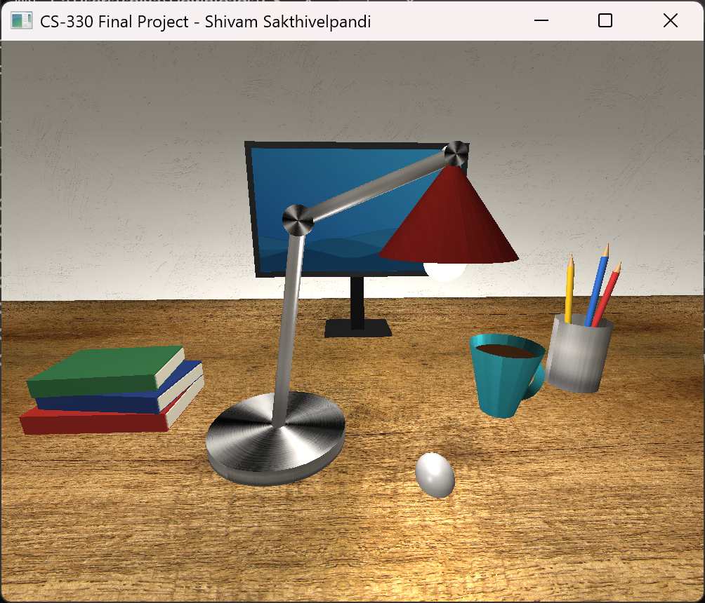

# CS 330 - Computational Graphics and Visualization

This repo has my final project for CS 330 at SNHU. It's a 3D desk scene made in C++ and OpenGL with a desk lamp, a monitor, a mouse, a stack of books, a coffee mug, and a pencil holder.

**What's in here**

- `3D_Scene_Final_Project.zip` - the Visual Studio project with all the source code, textures, and the EXE
- `Design_Decisions.docx` - my write-up of how I built the scene and why

To run it, put the project folder in `CS330Content/Projects/` (it uses the course's shared libraries and shaders) and open the .sln in Visual Studio 2022. The EXE is in the Release folder.

Controls: WASD to move, Q/E for up and down, mouse to look around, scroll wheel to change speed, P and O to switch between perspective and orthographic, ESC to quit.

---

## Reflection

### How do I approach designing software?

This project made me plan a lot more before writing code than I usually do. Before I touched OpenGL I had to break every object in my image down into basic shapes, like the lamp being a cylinder base, two cylinder arms, a cone shade and a half sphere bulb. Thinking about something complicated as a group of simple pieces is probably the biggest design skill I got out of this class.

My process was basically: sketch the scene, list the shapes for each object, decide where things go, then build one object at a time and check it against the sketch. For the lamp I picked three key points (base, elbow, head) and placed every part from those, so if I moved one point the whole lamp stayed connected. I want to keep doing that in future work. If a few values control the whole thing, changes are way easier and I don't end up chasing numbers all over the code.

### How do I approach developing programs?

I built the scene in small steps and ran it after almost every change. One object, then the camera, then textures, then lighting. A lot of problems only showed up when I actually looked at the window. The wood texture had seams when it was tiled, the camera turned away from the scene when the program started, and the first lighting pass washed everything out to white. Each of those took a few rounds of changing something, rebuilding, and looking again.

Iteration also meant going back to old work. Near the end I counted triangles and the lamp was over 2,000 because the joints were full spheres, so I redid the joints as flat hinge plates. I also went back and added the monitor, mouse and the tapered mug with the torus handle, because I had planned them in my earlier breakdown and hadn't built them yet.

My code also got more organized as the milestones went on. At first everything was in one long RenderScene function. By the end each object had its own function and I had helpers like DrawCylinderBetween, AddMaterial and SetLight that I reused everywhere. That made the last few milestones go a lot faster than the first ones.

### How can computer science help me in reaching my goals?

Graphics made a lot of the math from earlier classes feel real. Vectors, matrices, angles and transformation order stopped being abstract once I could see a shape end up in the wrong place because I rotated before I scaled. That should help in later classes that use linear algebra, data structures for scenes, or anything with simulations.

For work, a lot of software has some kind of visual part, like dashboards, data visualization, games, or apps with 3D previews. Knowing how a camera, projection, textures and lighting work underneath gives me a better idea of what a graphics library is doing for me. The habits from this project should carry over to any job too: breaking big problems into small pieces, testing as I go, and writing code someone else can read.
